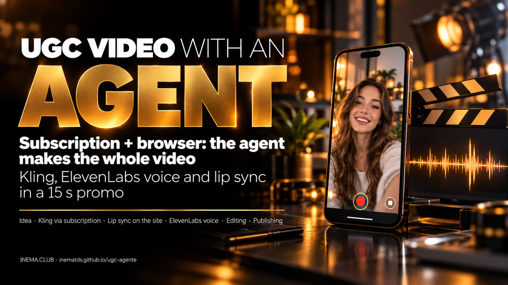

# 🎬 UGC with an agent — a promo video made by an AI agent

[](https://inematds.github.io/ugc-agente/guia/en/)

**🇧🇷 [Português](README.md) · 🇺🇸 [English](README.en.md) · 🇪🇸 [Español](README.es.md)**

## What it is

This project tells how an AI agent (Claude Code) produced a 15-second promo video for INEMA.CLUB in UGC style, the "real person talking to the camera" kind of video you see on social media. It is for content creators who want to hand production off to an agent. It shows the idea, the steps with the commands used, the tips that made a difference and the problems that came up along the way. To repeat it, you need a Kling AI subscription, an ElevenLabs account, ffmpeg, Python and a browser logged in to Kling.

## 📖 User guide

Full guide (idea, tips, problems and step by step): **https://inematds.github.io/ugc-agente/guia/en/**

## The main tip

**Use your subscription and give the agent the ability to operate the website.**

- The scenes came out of the Kling Pro subscription through the official CLI (`kling`): 120 credits, no API key.
- Kling's Lip Sync only exists on the website. The agent opened an already logged-in Chromium (`--remote-debugging-port`) and, through Playwright, uploaded the scenes, checked the cost on the button and downloaded the result: 10 more credits.

## How it was made

| Stage | Tool | Result |
|---|---|---|
| Scenes | `kling omni_ref_video` (v3.0 Omni, 15 s, 9:16, 1080p, no audio) | 3 shots from the reference image |
| Voice | ElevenLabs `eleven_multilingual_v2`, Amanda Kelly voice, speed 1.12 | 13.3 s, checked with Whisper |
| Text | `scripts/overlay.py` (Pillow) | 450 PNG frames synced with the speech |
| Lipsync | Kling website + `scripts/kling_lipsync_*.mjs` | scenes 1 and 3 with the mouth in sync |
| Editing | `scripts/montar.sh` (ffmpeg) | 15.000 s, no watermark, −14 LUFS |
| Publishing | [yt-pubx](https://github.com/inematds/yt-pubx) | [Short on YouTube](https://www.youtube.com/watch?v=XOyI6dT6ioQ) |

## Files

```
scripts/
  tts_elevenlabs.py          narration (key in ELEVENLABS_API_KEY)
  overlay.py                 1080x1920 text layer, 30 fps
  kling_lipsync_enviar.mjs   sends video + audio to the website's Lip Sync (checks the cost first)
  kling_lipsync_baixar.mjs   downloads only the requested results
  montar.sh                  cuts, swap for the lipsync scenes and final assembly
guia/                        guide page (PT, EN, ES)
```

## Problems that came up

Lipsync forgotten in the 1st version, Kling CLI without audio, a "no confirmation" submission that had gone through, downloading old jobs, watermark, rejected audio format (403), empty mp3, narration too long, empty frame 0, low-contrast text and an out-of-order contact sheet. The fix for each one is in the [guide](https://inematds.github.io/ugc-agente/guia/en/#problemas).

---

[INEMA.CLUB](https://inema.club) · open and free content
